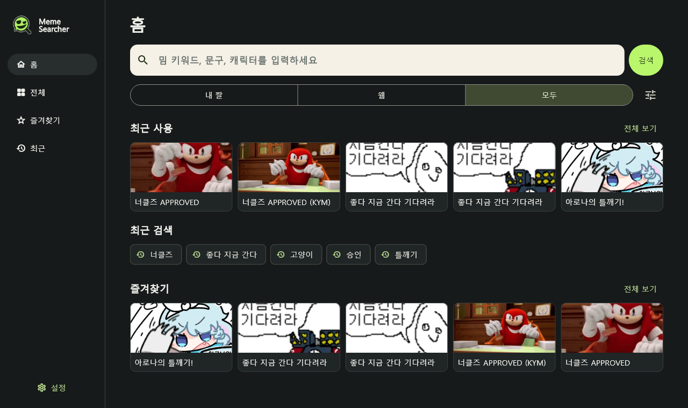

# 그 짤 어디 있었지?

“좋다 지금 간다 기다려라.” 대사는 기억나는데 저장한 폴더가 생각 안 날 때, **Meme Searcher**에 그 대사를 넣어 보세요. 내 짤과 웹에서 찾은 짤이 한 화면에 뜹니다. 보낼 짤을 열고 `Ctrl+C`, 채팅창에서 `Ctrl+V`.

**[Windows용 최신 버전 다운로드](https://github.com/JJHbrams/meme-searcher/releases/latest)** · Windows 10/11 x64 · 포터블 ZIP



*기본 제공 짤과 예시 사용 기록으로 구성한 홈 화면입니다.*

## 한 번 찾아 둔 짤, 또 써먹기

- **원본이냐 패러디냐.** `좋다 지금 간다 기다려라`로 케장콘과 헬다이버즈 버전을 함께 찾고, `#헬다2`를 붙여 원하는 버전으로 좁혀 보세요. 검색 범위는 **모두**가 기본이고, 형식은 **전체 / GIF / 이미지**로 고를 수 있습니다.
- **다음에도 쓸 짤은 별표.** 미리보기에서 별을 누르면 홈의 즐겨찾기에 들어갑니다. 홈에는 최근 사용한 짤, 최근 검색어, 즐겨찾기가 각각 최대 5개씩 보입니다. 검색어를 누르면 그 검색을 다시 실행합니다.
- **GIF는 움직이는 채로.** 이미지는 미리보기의 **복사**로 채팅창에 붙여넣으세요. GIF는 원본 파일로 복사합니다. 카카오톡에서 GIF 붙여넣기가 안 될 때는 **원본 저장**을 눌러 저장한 파일을 채팅창에 첨부하세요.

## 처음 실행하기

1. 릴리스의 **Assets**에서 `windows-x64.zip`으로 끝나는 파일을 받아 폴더 전체를 압축 해제하세요. DLL과 `data` 폴더가 함께 있는 상태에서 `meme_searcher.exe`를 실행합니다.
2. 첫 화면에서 **나중에**를 누르면 키 없이 기본 제공 짤부터 검색할 수 있습니다. Google 이미지 결과도 쓰려면 **Google 이미지 검색 연결**에서 SerpApi에 로그인한 뒤 **API 키 페이지 열기 → 키 복사 → 복사한 키로 연결**을 선택하세요. 나중에 **설정**에서도 연결할 수 있습니다.

<details>
<summary>검색 키와 원본 이미지</summary>

앱은 SerpApi 계정 API로 키를 확인하고 Windows 보안 저장소에 저장합니다. 키를 직접 입력하거나 `SERPAPI_API_KEY` 환경 변수를 쓸 수도 있습니다. 웹 검색 사용량과 요금은 연결한 서비스의 계정 정책을 따릅니다.

웹 원본을 열 수 없고 썸네일만 남아 있으면 **미리보기 이미지 복사**로 표시된 해상도의 이미지를 복사할 수 있습니다. 원본을 열 수 있다면 **파일로 복사**로 파일 자체를 첨부할 수도 있습니다.

</details>

<details>
<summary>Windows 실행 문제</summary>

배포 ZIP은 코드 서명되지 않아 Windows SmartScreen 경고가 표시될 수 있습니다. 실행 시 `VCRUNTIME` 또는 `MSVCP` DLL이 없다는 오류가 뜨면 Microsoft의 x64 런타임을 설치하세요. [VC++ v14 x64 다운로드](https://aka.ms/vc14/vc_redist.x64.exe) · [Microsoft 런타임 안내](https://learn.microsoft.com/en-us/cpp/windows/latest-supported-vc-redist/)

</details>

<details>
<summary>소스에서 빌드하거나 릴리스하기</summary>

Flutter 3.50, Dart 3.14, Visual Studio C++ Build Tools가 필요합니다.

```powershell
flutter pub get
powershell -NoProfile -File .\tools\prepare-flutter-windows.ps1
flutter build windows --release
```

일반 사용자 권한에서 첫 `flutter pub get`이 플러그인 심볼릭 링크 생성 중 실패하면 위 보조 스크립트로 디렉터리 junction을 준비한 뒤 `flutter pub get`과 빌드를 다시 실행하세요. Windows 보안 저장소 플러그인에는 Visual Studio ATL 없이 빌드하기 위한 로컬 패치가 포함되어 있습니다.

빌드한 EXE는 프로젝트 루트에서 바로 실행할 수 있습니다. 탐색기의 **속성 → 자세히**에서 네 자리 버전을 확인할 수 있습니다. 앞 세 자리는 `VERSION`, 마지막 자리는 CI 빌드 번호 또는 Git 커밋 수입니다. 아래 명령은 `dist`에 배포 ZIP과 `SHA256SUMS.txt`를 생성합니다.

```powershell
powershell -NoProfile -File .\tools\package-windows-release.ps1
```

GitHub에 게시하려면 최종 커밋에서 빌드한 뒤 주석 태그에 릴리스 노트를 입력하고 다음과 같이 배포합니다.

```powershell
$tag = 'v' + (Get-Item .\meme_searcher.exe).VersionInfo.FileVersion
git tag -a $tag
git push origin $tag
powershell -NoProfile -File .\tools\package-windows-release.ps1 -Publish
```

</details>

자체 소스에는 별도 라이선스가 지정되어 있지 않습니다. 포함된 소프트웨어와 밈의 권리자 및 원본 출처는 [서드파티 고지](THIRD_PARTY_NOTICES.md)에서 확인할 수 있습니다.
