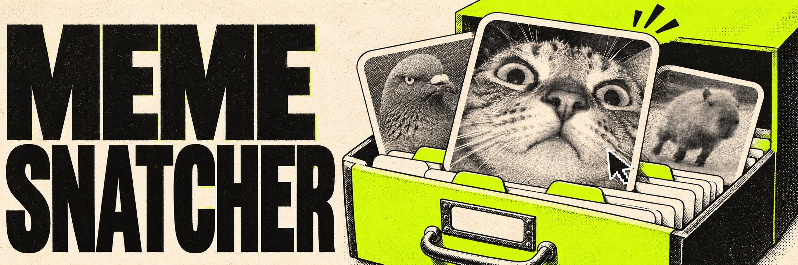
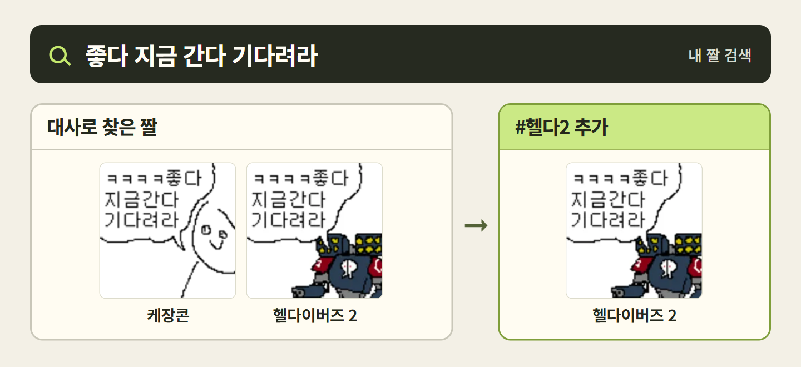

# Meme Snatcher · 대사는 기억나는데, 그 짤 어디 있지?

파일 이름 대신 기억나는 대사를 넣어 보세요. **내 짤과 웹에서 찾은 이미지를 한 화면**에 모아 검색어와 잘 맞는 순서로 보여주는 Windows용 밈 검색기예요.

**[Windows용 다운로드](https://github.com/JJHbrams/meme-searcher/releases/latest)** · Windows 10/11 x64 · ZIP 전체 압축 해제 → `meme_searcher.exe` 실행

## “좋다 지금 간다 기다려라” …헬다이버 버전이었는데?

<picture>
  <source media="(max-width: 600px)" srcset="docs/media/find-your-meme-mobile.png">
  
</picture>

직접 해보려면 **내 짤**에서 `좋다 지금 간다 기다려라 #헬다2`를 검색하세요. 기본 제공 짤이라 가입 없이 해볼 수 있어요. [실제 검색 화면 보기](docs/media/search-results.png)

## 찾았으면 써먹어야지

| 하고 싶은 일 | 이렇게 쓰세요 |
| --- | --- |
| 💬 지금 채팅에 답장하기 | 짤 열기 → <kbd>Ctrl</kbd> + <kbd>C</kbd> → 채팅창에서 <kbd>Ctrl</kbd> + <kbd>V</kbd> |
| 🎞️ 카톡에 움직이는 GIF 보내기 | **원본 저장** → 카카오톡에서 **파일 첨부** |
| ⭐ 웹에서 건진 짤 또 쓰기 | **내 짤에 저장** → **☆ 즐겨찾기** → 다음엔 **홈**에서 바로 열기 |

🐚 **심심할 땐 마법의 소라고동.** 메뉴에서 질문을 쓰고 고리를 당겨 보세요. 소원을 빌고 싶은 날엔 옆에 있는 원 위시 윌로우의 가지를 꺾으세요.

## 내 서랍 밖에서도 찾으려면

기본 검색 범위는 **모두**예요. 내 짤과 네이버 이미지 결과를 함께 보고, 설정에서 본인 SerpApi 키를 연결하면 **Google 이미지**까지 같은 결과 목록에 들어와요. 움직이는 짤만 보고 싶으면 **GIF**를 누르세요. [Google 이미지 연결 방법](docs/guide.md#google-이미지-연결)

[홈 화면 보기](docs/media/home.png) · [실행 도움말](docs/guide.md#실행-문제) · [개발 빌드](docs/guide.md#개발-빌드) · [콘텐츠 출처와 권리](THIRD_PARTY_NOTICES.md)
