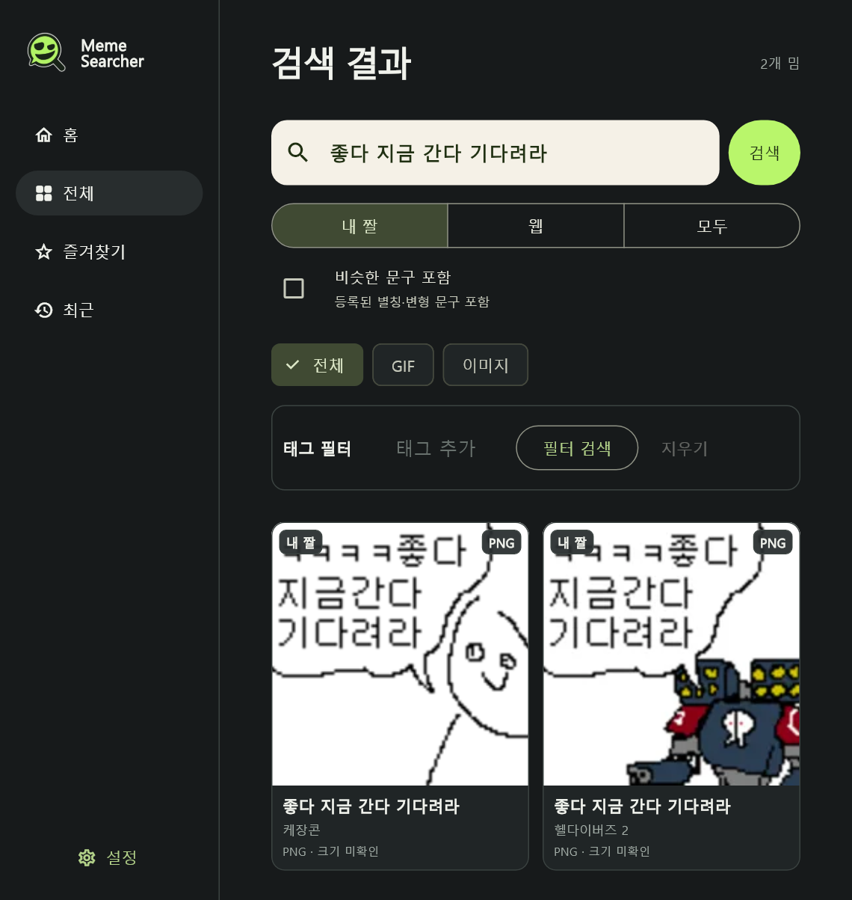

# 그 짤 어디 있었지?

기억나는 대사로 **내 짤과 웹을 한 번에 검색**하세요. 찾은 짤은 `Ctrl+C` → 채팅창에서 `Ctrl+V`.

**[Windows용 다운로드](https://github.com/JJHbrams/meme-searcher/releases/latest)** · Windows 10/11 x64 · ZIP을 풀고 `meme_searcher.exe` 실행

## 같은 대사, 다른 짤

*`좋다 지금 간다 기다려라`로 두 짤을 찾고, `#헬다2`를 붙이면 오른쪽 패러디만 남아요.*

- **또 쓸 짤**은 미리보기에서 ☆ 즐겨찾기.
- **카톡에 보낼 GIF**는 **원본 저장 → 파일 첨부**.

기본 짤은 키 없이 바로 검색할 수 있어요. [Google 이미지 연결](docs/guide.md#google-이미지-연결)

[홈 화면 보기](docs/media/home.png) · [실행 도움말](docs/guide.md#실행-문제) · [개발 빌드](docs/guide.md#개발-빌드) · [콘텐츠 출처와 권리](THIRD_PARTY_NOTICES.md)
