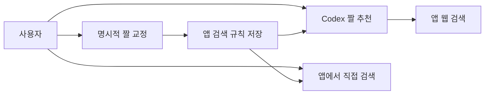
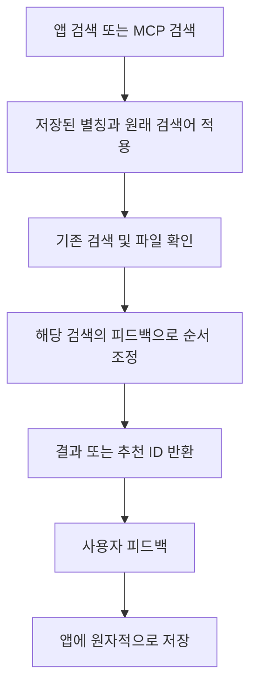
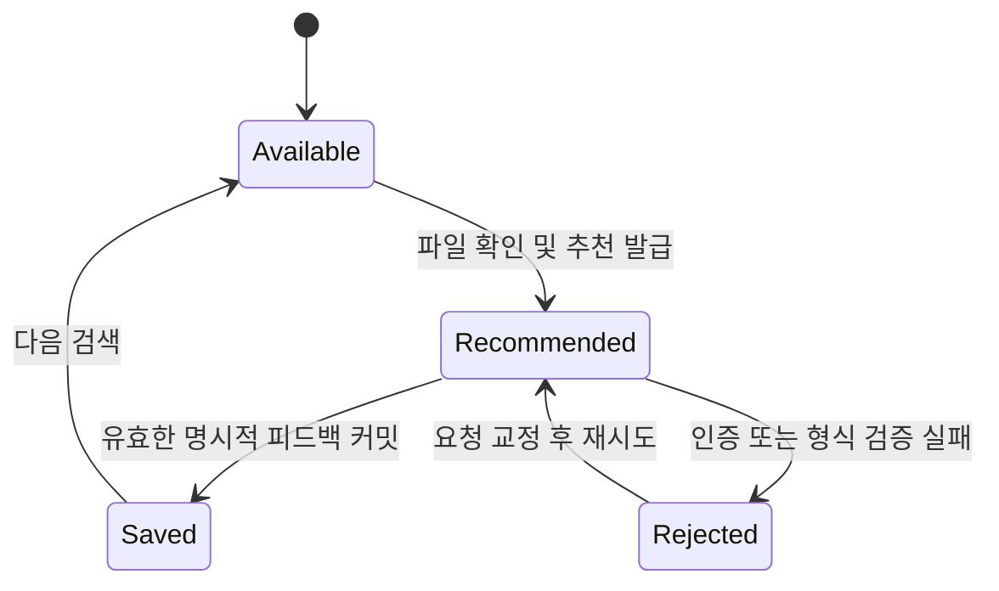
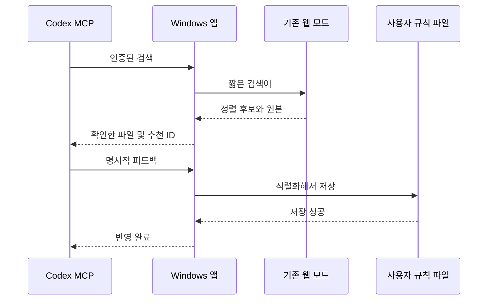
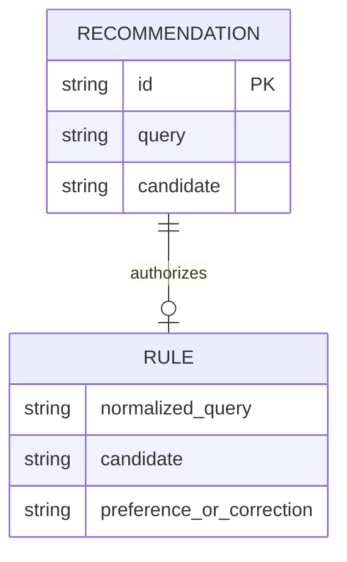

# MCP 웹 검색과 앱 피드백 학습

## 1. 의도 (Intent)

| 항목 | 내용 |
|---|---|
| 문제 | Codex 짤 추천은 기본 짤과 즐겨찾기로 제한되고 교정이 앱 검색에 축적되지 않는다. |
| 왜 지금 | 대사의 기억 표기나 장면 설명을 직접 알려 주면 다음 앱 검색에서 찾을 수 있어야 한다. |
| 주 사용자 | Codex와 Windows Meme Snatcher를 함께 쓰며 짤을 제안받거나 앱에서 직접 검색하는 사람. |
| 불변식 | 앱의 웹 모드, 공급자, 파일 검증을 재사용한다. SerpApi 키는 앱이 소유한다. 검색 규칙에는 명시적으로 준 피드백만 남긴다. |
| 비목표 | 원격 동기화와 자동 모델 학습은 범위 밖이다. |

## 2. 수용 기준 (Acceptance)

| ID | 수용 기준 | 검증 방법 |
|---|---|---|
| AC-1 | MCP의 `web` 또는 로컬 후보가 없는 `auto`가 기존 앱 웹 검색을 사용한다. 선택 결과로 유효한 이미지 또는 GIF의 로컬 원본을 반환한다. | 실제 MCP stdio와 앱 HTTP 연결을 사용한 통합 테스트에서 기존 앱 서비스로 주입한 공급자의 검색어와 반환 파일을 대조한다. |
| AC-2 | 추천에 대해 긍정 또는 다른 짤이라는 피드백을 주면 같은 검색의 적합한 후보 순서가 달라진다. | 공급자와 후보 데이터를 고정한 뒤 추천 기록으로 피드백을 넣고 새 앱 검색의 첫 후보를 검증한다. |
| AC-3 | `망했어요` 장면 교정을 저장한 후 Codex와 앱을 재시작해도 앱에서 `망했어요`를 입력하면 보정된 검색과 결과 정렬이 적용된다. | 저장 디렉터리만 공유하는 새 앱 서비스에서 기본 검색 진입점을 호출해 공급자 검색어와 첫 결과, 원래 검색어 유지를 확인한다. |
| AC-4 | 로컬 단독 실행은 기존처럼 작동하고, 공식·민감한 상황, 인증 실패, 유효하지 않은 추천은 검색 또는 학습을 일으키지 않는다. | stdio 로컬 회귀와 루프백 인증·요청 검증 테스트를 실행한다. |

## 3. 확정 사실 (Findings)

| 항목 | 확인된 사실 | 설계 반영 |
|---|---|---|
| 앱 검색 | `DeviceAppServices.search`가 `QueryPlanner`와 `RankingService`, 네이버와 SerpApi 수집기를 사용한다. | 앱과 MCP가 같은 검색 경로를 쓴다. |
| 원본 선택 | `DeviceAppServices.loadMedia`가 원본 확인과 캐시를 처리한다. | MCP에는 검증된 로컬 첨부 경로를 반환한다. |
| 실행 범위 | 현재 Node MCP는 기본 짤과 파일이 남은 즐겨찾기를 읽는다. | Windows 앱이 연결되면 공통 검색·피드백을 쓰고, 떨어지면 기존 로컬 경로를 유지한다. |
| 사용자 지시 | 사용자가 MCP 피드백을 앱 검색에도 적용하는 완료 기준에 동의했다. | 복원 후 직접 검색을 수용 기준에 둔다. |

## 4. 유스케이스 / 시나리오

사용자는 짤 제안 뒤 장면을 교정한다. 원래 입력으로 앱에서 검색하면 앱이 보정 검색어를 사용한다. 앱 연결이 없으면 로컬 MCP 추천은 계속 쓸 수 있다.

## 5. 파이프라인 (flowchart)

## 6. 액션 · 상태 전이 (action diagram)

| 상태 | 저장/이벤트 | UI 반응 |
|---|---|---|
| Recommended | 앱 프로세스가 추천과 후보를 연결한다. | Codex가 짤 한 장을 제시한다. |
| Saved | 쓰기가 성공하면 앱 검색이 같은 규칙을 읽는다. | 피드백 저장 여부가 표시된다. |
| Rejected | 기존 검색 규칙을 유지한다. | 앱 연결이나 가능한 교정 방법을 알린다. |

## 7. 타이밍 (sequence)

MCP 호출 제한은 기존 앱 수집·검증 시간을 수용하도록 둔다. 앱 연결 확인에 실패하면 로컬 조회는 짧은 시간 안에 폴백한다.

## 8. 데이터 (ER)

새 버전의 규칙 파일은 기존 서랍 인덱스와 독립이다. 추천 ID는 앱이 발급하며 기존 규칙의 수명은 추천 ID와 독립이다.

## 9. 변경 지점

| 파일 | 변경 |
|---|---|
| `lib/core/device_app_services.dart` | 앱과 MCP가 공유하는 검색에 규칙을 적용한다. |
| `lib/core/query_plan.dart` | 별칭 교정과 원래 입력을 함께 다룬다. |
| `lib/core/meme_feedback_store.dart` (신규) | 검색 규칙 읽기, 저장, 정렬을 관리한다. |
| `lib/core/meme_mcp_bridge.dart` (신규) | Windows 사용자 범위 루프백 연결과 추천 피드백을 처리한다. |
| `lib/main.dart` | 앱 실행과 연결 수명을 연결한다. |
| `tools/meme-snatcher-mcp.mjs` | 웹 범위, 피드백 도구, 로컬 폴백을 제공한다. |

## 10. 잠재 문제 & 대응

| 문제 | 대응 |
|---|---|
| 공급자 후보의 제목과 주소가 변한다. | 원본 주소와 안정적인 식별자를 사용하고 기존 관련성 필터 안에서 조정한다. |
| 앱이 꺼졌거나 주소 파일이 남는다. | 환경과 토큰을 확인한 루프백 연결만 사용한다. 로컬 추천은 폴백한다. |
| 교정 검색어가 본래 입력보다 길다. | 검색 의도만 보정하고 원래 입력과 태그를 유지한다. |

## 11. 착수 순서

- [x] 1. 규칙 파일과 앱 직접 검색을 연결한다. (AC-2, AC-3)
- [x] 2. 앱 웹 검색과 stdio MCP를 잇고 로컬 폴백을 검증한다. (AC-1, AC-4)

## 12. 추적성

| AC | 구현 | 검증 | 위험 항목 |
|---|---|---|---|
| AC-1 | 앱 브리지와 기존 검색 | `test/core/meme_mcp_bridge_test.dart`의 실제 stdio·루프백 통합 테스트와 모의 공급자 | 공급자 실패 |
| AC-2 | 검색 결과에 명시적 선호 적용 | `test/core/meme_feedback_store_test.dart`와 고정 후보 순위 비교 | 순서 오염 |
| AC-3 | 검색 계획과 영속 규칙 | 서비스 재시작 후 직접 검색 및 원래 검색어·보정 검색어 대조 | 교정 유실 |
| AC-4 | 로컬 폴백과 인증·검증 | 앱이 닫힌 상태의 GIF, 인증·잘못된 요청·비공개 상황 회귀 | 무단 요청 |
