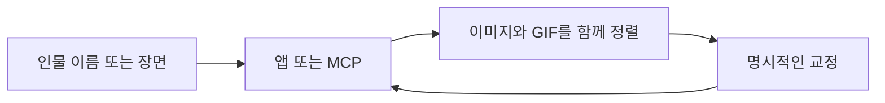
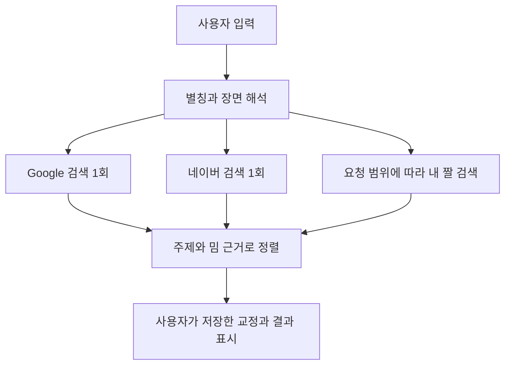
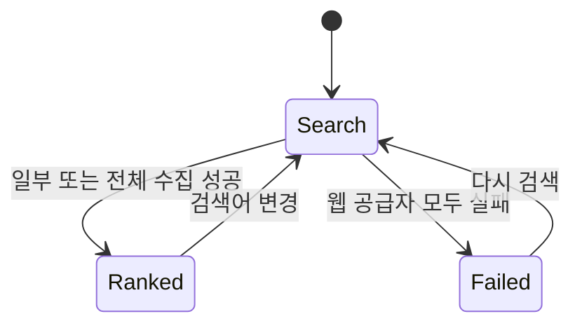

# 이름과 장면으로 밈 찾기

## 1. 의도

이름이나 기억나는 표현으로도 관련 밈을 먼저 볼 수 있다. 사전은 입력 별칭을 인물·장면과 연결하고, 앱이 웹 수집과 정렬에 읽는 단서를 제공한다. 앱과 MCP가 같은 경로를 사용한다. Google 호출은 검색당 최대 한 번이며 로컬·웹 통합, 태그, 형식, 명시적 피드백을 유지한다. 검색 형식은 이미지와 GIF다.

## 2. 수용 기준

| ID | 기준 | 검증 방법 |
|---|---|---|
| AC-1 | 젠슨 황의 한국어, 영문, 오타 입력을 같은 인물로 해석한다. 현재 패러디와 고전 장면을 함께 찾는다. | 날짜를 고정해 검색어와 만료 전후 결과를 비교한다. |
| AC-2 | 관련 패러디를 인물 사진과 무관한 짧은 영상보다 높인다. 사전에 없는 주제에서도 밈과 검색 주제를 함께 본다. | 동일 후보로 기존 점수와 새 점수의 상위 순위를 비교한다. |
| AC-3 | 기본 검색과 MCP는 같은 규칙을 활용하며 저장된 사용자 교정과 형식 조건을 적용한다. | 앱 서비스, MCP 브리지, 검색 품질 회귀 테스트를 실행한다. |
| AC-4 | 등록되지 않은 검색과 제목이 짧은 후보도 검색할 수 있고, 공급자 호출이 증가하지 않는다. | 검색어와 소스별 호출 수를 고정 공급자에서 확인한다. |

## 3. 확정 사실

| 관찰 | 근거 |
|---|---|
| 앱과 MCP는 `DeviceAppServices.search`에서 웹 수집과 정렬을 공유한다. | 앱 서비스와 MCP 브리지 코드 |
| 기존 미등록 영문 입력은 밈 수식어가 없고 한국어에는 ‘짤’을 붙인다. | 기존 `QueryPlanner` |
| 기존 기본 점수는 핵심어·태그·GIF·상업성 등을 보지만 인물 초상과 패러디를 따로 보지 않는다. | 기존 `RankingService` |
| 젠슨 황 이름으로 서로 다른 시기의 패러디 단서를 확인했다. | [Al Vigier의 The Office 패러디](https://www.youtube.com/watch?v=xmcNIQD4sdw), [NVIDIA의 주방 장면](https://www.youtube.com/watch?v=So7TNRhIYJ8), [NVIDIA 복귀 공지](https://nvidianews.nvidia.com/news/nvidia-board-reinstates-jensen-huang-as-president-ceo-and-board-director/) |
| 소리 기억과 인물·작품을 연결하면 제목이 달라도 장면을 지정할 수 있다. | [Whoopah Chandler GIF](https://tenor.com/view/whoopah-chandler-friends-woop-gif-9170443) |
| 해외 인기 템플릿 100개 중 제목에 `meme`이 있는 항목은 1개다. | [Imgflip의 상위 템플릿 API](https://imgflip.com/api), 2026-11-27 제목 집계 |
| 한국어 밈 범주 347개에서 대사·표현 관련 단어 198개, 매체·커뮤니티 관련 단어 129개, 변형·패러디 관련 단어 77개가 나왔다. 항목 중복을 허용한 메타데이터 집계다. | [KoCulture-Descriptions](https://huggingface.co/datasets/huggingface-KREW/KoCulture-Descriptions), 503개 원자료 중 범주 `meme` 347개, 2026-11-27 |

## 4. 유스케이스

## 5. 파이프라인

## 6. 상태 전이

| 상태 | 저장과 표시 |
|---|---|
| Search | 원래 입력과 태그를 유지한다. |
| Ranked | 같은 원본을 합치고 제목과 출처 근거에 따라 순서를 정한다. |
| Failed | 기존 공급자 오류를 표시한다. |

## 9. 변경 지점

| 파일 | 역할 |
|---|---|
| `lib/core/meme_search_profiles.dart` (신규) | 별칭, 인물·장면 단서, 기한이 있는 유행 |
| `lib/core/meme_search_rules.dart` (신규) | 입력을 검색 의도로 해석하고 제목·출처의 근거를 구분 |
| `lib/core/query_plan.dart` | 검색 엔진별 검색어와 적용할 단서를 계산 |
| `lib/core/web_collectors.dart` | 네이버 검색어와 이름 확인 |
| `lib/core/ranking_service.dart` | 후보의 주제와 패러디 단서를 점수에 적용 |
| `lib/core/device_app_services.dart` | 공급자별 검색 기록과 응답 캐시 |

## 10. 잠재 문제

| 문제 | 대응 |
|---|---|
| 소셜 도메인만 보고 관련 밈으로 판단 | 제목, 경로의 인물·장면 근거와 함께 사용 |
| 일반 인물 이름으로 후보 전체를 차단 | 알 수 없는 후보는 낮은 순위에 두고 명확한 근거를 우선 |
| 이미지 검색 공급자가 확인된 장면을 수집하지 못함 | 두 공급자에 다른 단서를 전달한다. 원본 결과가 없으면 웹 검색에 있던 후보만 사용한다. |
| 유행이 지나도 검색어가 고정 | 날짜 만료 후 고전 검색어로 복귀하며 기본 밈 검색 유지 |
| 영상 게시물의 직접 재생 | 기존 공급자가 반환하는 이미지·GIF를 대상으로 한다. |

## 11. 착수순서

- [x] 국내·해외 표본의 별칭과 단서를 등록하고 검색어를 계산한다. (AC-1, AC-4)
- [x] 두 공급자와 통합 정렬에서 후보 단서를 적용한다. (AC-2, AC-3)
- [x] 실제 수집 결과와 회귀 테스트를 대조한다. (AC-1, AC-2, AC-3, AC-4)

## 확인 결과

| 입력 | 확인 |
|---|---|
| `Jenson Hwang` | 네이버 실측에서 기존 1건은 다른 인물이었다. 새 규칙은 한국어 이름과 같은 검색어를 보내고 밈 관련 게시물을 상위에 배치했다. |
| `젠슨 황` | 새 규칙에서 패러디 게시물이 먼저, 관련 보도가 다음에 표시됐다. 실측은 이미지 URL과 제목·출처를 비교했다. |
| `망했어요` | 박정욱의 경기 중계 대사를 다룬 네이버 결과가 첫 번째였다. |
| `wapa~` | 알려진 Chandler 장면으로 검색어를 변환했다. 네이버 실측에서 정확한 원본은 수집되지 않았다. |

위 네이버 비교에서는 Google 순위를 측정하지 않았다. 앱 테스트는 Google 요청의 대상, GIF 옵션, 모의 후보의 통합 정렬과 저장 교정을 확인한다. 인스타그램과 틱톡에 직접 로그인하거나 유행을 자동 수집하지 않는다.

## 미등록 인물의 최근 밈

태그, 명시한 장면, 사용자 교정 없이 모르는 이름이 들어오면 Google 이미지의 공식 기간 옵션으로 최근 30일 후보를 모은다. 네이버는 기간 제한이 없는 검색으로 오래된 장면도 제공한다. 공급자별 검색 횟수는 한 번이다. Google 기간 필터를 통과한 결과라도 검색한 이름·밈 단서에 더해 출처 URL의 날짜 또는 X 게시물 ID에 담긴 발행 시각이 기간 안에 있어야 최신 가산점을 준다. [X 게시물 ID 생성 방식](https://github.com/twitter-archive/snowflake/blob/snowflake-2010/src/main/scala/com/twitter/service/snowflake/IdWorker.scala) Google 결과가 상위 세 자리를 차지할 때 기간 제한 없는 검색에 강한 밈 후보도 있으면 함께 보여 준다. 앞선 후보에 날짜가 확인된 최근 밈이 있을 때에는 세 번째에, 날짜 근거가 없을 때에는 첫 번째에 배치한다. 명시적 사용자 피드백은 최종 순서에 적용한다. 발행 시각은 게시물의 나이를 알려 주며 조회수, 확산 속도, 밈의 최초 제작일은 알 수 없다.

2026-11-27에 사전에 없는 `Elon Musk`, `Pedro Pascal`, `김두한`을 기존 SerpApi Google Images 수집기로 기간 없음과 최근 30일로 각각 확인했다. 여섯 요청 모두 성공했고, 최근 쿼리의 실제 Google URL에 기간 조건이 들어갔다. 개별 이미지에는 별도 게시 시각 필드가 없었다. 기간 조건을 적용한 Elon Musk 상위 결과에 몇 년 전 Reddit 글이 남았다. Google 최근 검색 상위 5개에 없는 김두한 사딸라 움짤은 네이버 전체 기간 검색에서 1위였다. [Reddit 게시물](https://www.reddit.com/r/terriblefacebookmemes/comments/v4kxrw/not_another_meme_featuring_elon_musk/) [Google Images 기간 옵션](https://serpapi.com/google-images-api#time-period)
